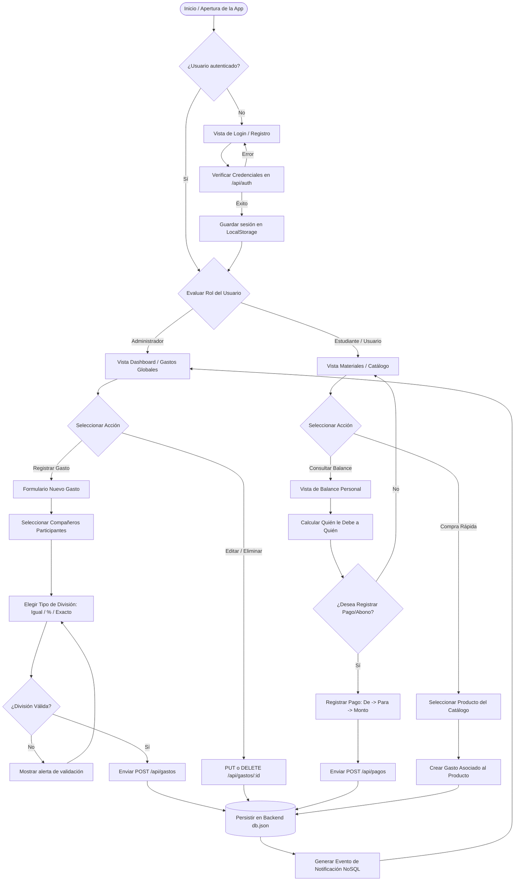
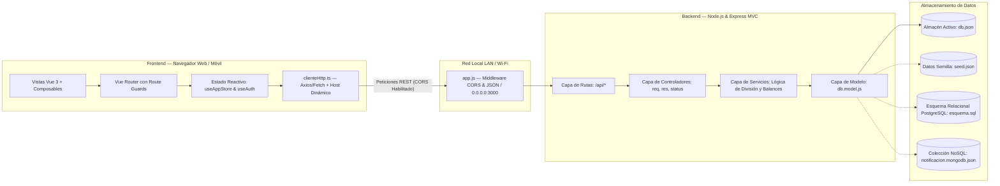

# 🎓 UJAP Split — Gestor Colaborativo de Gastos Universitarios

> **Asignatura:** Tópicos Especiales de Programación Web  
> **Institución:** Universidad José Antonio Páez (UJAP)  
> **Tecnologías:** Vue 3 · TypeScript · Vite · Express (MVC) · PostgreSQL · MongoDB (NoSQL)

---

## 📖 1. Descripción del Proyecto

**UJAP Split** es una aplicación web full-stack diseñada para resolver una necesidad cotidiana de la comunidad estudiantil: **la gestión, división equitativa y liquidación de gastos compartidos** en proyectos académicos, fotocopias, materiales de laboratorio, papelería y actividades grupales.

La plataforma permite a grupos de estudiantes registrar compras o gastos comunes, seleccionar qué compañeros participan en cada compra, elegir la modalidad de división (partes iguales, porcentaje o montos exactos), calcular saldos netos entre los participantes y registrar abonos para saldar deudas de manera transparente y en tiempo real.

### ✨ Características Principales

- **Gestión Inteligente de Gastos:**
  - Registro de compras con descripción, fecha, categoría de producto y pagador.
  - **3 modalidades de división:**
    1. *Equitativa (partes iguales):* El monto total se divide en partes iguales entre los participantes seleccionados.
    2. *Porcentual (%):* Cada participante asume un porcentaje personalizado (la suma debe totalizar 100%).
    3. *Monto exacto ($):* Se especifica la cantidad monetaria exacta asignada a cada compañero.
- **Cálculo Automatizado de Balances y Deudas:**
  - Matriz de balances netos que determina de forma automática **quién le debe a quién**.
  - Evita transferencias circulares o cálculos manuales propensos a error.
- **Liquidación y Abono de Deudas:**
  - Los estudiantes pueden registrar abonos o pagos totales asociados a un gasto o al balance global entre compañeros.
- **Catálogo de Materiales Universitarios:**
  - Módulo con productos académicos categorizados (impresiones, hojas, cuadernos, útiles de dibujo, alquiler de equipos).
  - Permite imputar rápidamente compras directas basadas en el catálogo.
- **Sistema de Roles y Control de Acceso:**
  - **Administrador:** Panel de métricas globales (dashboard), visualización de todos los gastos del grupo, creación, edición y eliminación de gastos (CRUD completo).
  - **Estudiante / Compañero:** Acceso enfocado en el catálogo de materiales, consulta de su balance personal (a favor / en contra) y registro de pagos.
- **Soporte Multi-Dispositivo en Red Local (LAN):**
  - Servidor backend y frontend configurados para escuchar en todas las interfaces de red (`0.0.0.0`), permitiendo el uso simultáneo desde computadoras, tablets y teléfonos móviles conectados a la misma red Wi-Fi.

---

## 📊 2. Diagramas de Flujo y Arquitectura

### 2.1 Diagrama de Flujo: Ciclo de Vida del Usuario y Gestión de Gastos



---

### 2.2 Diagrama de Arquitectura del Sistema



---

## 📦 3. Dependencias y Requisitos del Entorno

### 3.1 Requisitos del Sistema
- **Node.js:** Versión `^22.18.0` o `>=24.12.0` recomendada (mínimo LTS v18+).
- **npm:** Versión `10.x` o superior.
- **Navegador Web:** Chrome, Microsoft Edge, Brave, Mozilla Firefox o Safari moderno.
- **Sistema Operativo:** Windows, macOS o Linux.

### 3.2 Dependencias de Producción (`dependencies`)

| Paquete | Versión | Propósito en el Proyecto |
| :--- | :---: | :--- |
| **`vue`** | `^3.5.40` | Framework progresivo para la construcción de interfaces reactivas mediante la *Composition API*. |
| **`vue-router`** | `^5.3.0` | Enrutador oficial para SPA, con control de navegación según roles (`requiereAdmin`, `requiereAuth`). |
| **`express`** | `^5.3.0` | Framework de servidor web para Node.js que implementa la API REST bajo el patrón arquitectónico MVC. |
| **`cors`** | `^2.8.6` | Middleware de Express para permitir el intercambio de recursos entre orígenes cruzados (Frontend en `:5173` y Backend en `:3000`). |
| **`dotenv`** | `^18.0.6` | Gestión y carga de variables de entorno desde el archivo `.env`. |

### 3.3 Dependencias de Desarrollo (`devDependencies`)

| Paquete | Versión | Propósito en el Proyecto |
| :--- | :---: | :--- |
| **`vite`** | `^8.1.5` | Servidor de desarrollo con Hot Module Replacement (HMR) y empaquetador de producción ultrarrápido. |
| **`typescript`** | `~6.0.0` | Soporte de tipado estático para robustez del código y detección de errores en tiempo de desarrollo. |
| **`vue-tsc`** | `^3.3.7` | Herramienta de verificación de tipos TypeScript específica para componentes `.vue`. |
| **`npm-run-all2`** | `^9.0.2` | Utilidad CLI para ejecutar múltiples scripts de npm en paralelo (`npm run dev:all`). |
| **`@vitejs/plugin-vue`**| `^6.0.8` | Plugin oficial de Vite para la compilación de Single File Components (SFC) de Vue. |
| **`@types/node`** | `^24.13.3` | Definiciones de tipos de TypeScript para APIs del entorno Node.js. |

---

## 🚀 4. Guía de Instalación y Ejecución

Sigue estos pasos para clonar, instalar y poner en marcha el proyecto en cualquier computadora:

### Paso 1: Clonar el Repositorio
```bash
git clone https://github.com/luis-araujo23/tarea_maria_miercoles_old.git
cd tarea_maria_miercoles_old
```

### Paso 2: Instalar Dependencias
Instala todos los paquetes requeridos tanto para el frontend como para el backend:
```bash
npm install
```

### Paso 3: Configurar Variables de Entorno
Crea el archivo `.env` a partir de la plantilla `.env.example`:
```bash
# En Windows PowerShell:
Copy-Item .env.example .env

# En Linux / macOS / Git Bash:
cp .env.example .env
```

Contenido predeterminado de `.env`:
```ini
PORT=3000
VITE_API_URL=http://localhost:3000
```

---

### Paso 4: Iniciar la Aplicación

#### Opción A: Modo Todo-en-Uno (Recomendado)
Inicia de forma simultánea el **servidor backend Express** (puerto `3000`) y el **servidor frontend Vite** (puerto `5173`):
```bash
npm run dev:all
```
*(También puedes usar el alias `npm start`).*

#### Opción B: Ejecución en Terminales Separadas
Si prefieres ver los registros de consola del frontend y del backend por separado:

- **Terminal 1 — Backend Express:**
  ```bash
  npm run server
  ```
  *Estará disponible en:* `http://localhost:3000/api/`

- **Terminal 2 — Frontend Vue 3:**
  ```bash
  npm run dev
  ```
  *Estará disponible en:* `http://localhost:5173/`

---

### Otros Scripts Útiles

| Comando | Acción |
| :--- | :--- |
| `npm test` | Ejecuta la suite completa de pruebas automatizadas (Vitest + Supertest). |
| `npm run type-check` | Ejecuta la verificación estricta de tipos con `vue-tsc`. |
| `npm run build` | Valida tipos y compila la versión optimizada de producción en la carpeta `dist/`. |
| `npm run preview` | Previsualiza localmente el paquete de producción generado por Vite. |

---

## 🌐 5. Uso Multi-Dispositivo en Red Local (LAN)

Una de las características clave del proyecto es su capacidad para **funcionar en múltiples computadoras, laptops o teléfonos inteligentes** conectados a la misma red local (Wi-Fi o cable Ethernet):

1. **Escucha en todas las interfaces de red (`0.0.0.0`):**
   - El backend Express arranca en `0.0.0.0:3000`.
   - El frontend Vite arranca con el parámetro `--host` en `0.0.0.0:5173`.
2. **CORS Habilitado Globalmente:**
   - En `server/app.js`, el middleware `cors()` permite peticiones provenientes de cualquier IP de la red local.
3. **Resolución Inteligente de la IP del Servidor:**
   - El cliente HTTP en el frontend (`src/services/clienteHttp.ts`) detecta dinámicamente si el navegador está navegando desde `localhost` o desde una IP de red (ej. `192.168.1.45`), redirigiendo las llamadas al backend correspondiente sin configuraciones manuales.
4. **Base de Datos Compartida en Tiempo Real:**
   - Cualquier acción realizada desde una PC (ej. registrar un gasto) se guarda inmediatamente en `server/data/db.json`. Los demás dispositivos verán los cambios reflejados al consultar la aplicación.

### ¿Cómo conectarse desde otra PC o celular?
1. Conecta el dispositivo a la **misma red Wi-Fi** que la computadora principal.
2. Observa la consola al iniciar `npm run dev:all`. Verás la dirección IP asignada a tu máquina (por ejemplo `http://192.168.1.50:5173`).
3. Abre el navegador en el segundo dispositivo e ingresa la URL:
   ```
   http://<IP_DE_TU_PC>:5173
   ```
4. Para comprobar la conectividad directa con el backend, abre:
   ```
   http://<IP_DE_TU_PC>:3000/api/health
   ```

> [!TIP]
> Si otro dispositivo no puede acceder, asegúrate de que el Firewall de Windows permita el tráfico entrante en los puertos **5173** (Vite) y **3000** (Express).

---

## 👥 6. Cuentas de Acceso y Credenciales Demo

El sistema viene precargado con cuentas de prueba listas para usar:

| Nombre | Correo Electrónico | Contraseña | Rol | Acceso y Permisos |
| :--- | :--- | :---: | :---: | :--- |
| **Administrador** | `admin@ujap.edu.ve` | `1233` | **`admin`** | Acceso total al Dashboard, gestión global de gastos, edición, eliminación y métricas financieras. |
| **María** | `maria@ujap.edu.ve` | `1233` | **`usuario`** | Vista de materiales, consulta de balance propio, deudas pendientes y registro de pagos. |
| **Juan** | `juan@ujap.edu.ve` | `1233` | **`usuario`** | Vista de materiales, consulta de balance propio y registro de pagos. |
| **Carlos** | `carlos@ujap.edu.ve` | `1233` | **`usuario`** | Vista de materiales, consulta de balance propio y registro de pagos. |

> [!NOTE]
> **Nuevo Registro (Signup):** Cualquier persona puede registrar una cuenta nueva desde la pantalla de Registro. El sistema le asignará automáticamente un perfil de compañero vinculado para que pueda participar en divisiones de gastos.

---

## 🏛️ 7. Arquitectura Backend (Patrón MVC)

El backend Express fue desarrollado siguiendo el patrón de diseño **Modelo-Vista-Controlador (MVC)** enfocado en servicios de API REST:

```
server/
├── data/
│   ├── seed.json              <- Datos iniciales de catálogo, compañeros y categorías
│   └── db.json                <- Almacén de persistencia activo compartido en red
├── routes/                    <- Definición de endpoints y enrutamiento HTTP
│   ├── gastos.routes.js       <- CRUD de gastos
│   ├── productos.routes.js    <- Catálogo de productos
│   ├── categorias.routes.js   <- Categorías de materiales
│   ├── companeros.routes.js   <- Participantes del grupo
│   ├── pagos.routes.js        <- Registro de pagos y abonos
│   ├── auth.routes.js         <- Autenticación y registro
│   ├── notificaciones.routes.js <- Documentos de eventos NoSQL
│   ├── estado.routes.js       <- Sincronización y reinicio de datos
│   └── index.js               <- Router principal montado en /api/
├── controllers/               <- Controladores HTTP (manejo de req, res y status)
│   ├── gastos.controller.js
│   ├── productos.controller.js
│   ├── categorias.controller.js
│   ├── companeros.controller.js
│   ├── pagos.controller.js
│   ├── auth.controller.js
│   ├── notificaciones.controller.js
│   └── estado.controller.js
├── services/                  <- Capa de lógica de negocio y cálculos matemáticos
│   ├── gastos.service.js      <- Algoritmos de división (igual, porcentaje, exacto)
│   ├── productos.service.js
│   ├── categorias.service.js
│   ├── companeros.service.js
│   ├── pagos.service.js       <- Ajuste y balance de deudas
│   ├── auth.service.js
│   └── estado.service.js
├── models/                    <- Capa de acceso a datos y persistencia en disco
│   └── db.model.js
├── app.js                     <- Configuración de Express, CORS y middlewares
└── server.js                  <- Punto de entrada del servidor (puerto 3000, 0.0.0.0)
```

---

## 🔄 8. Endpoints de la API REST

### CRUD Completo de Gastos (Entidad Principal)

| Método | Endpoint | Descripción | Códigos HTTP |
| :---: | :--- | :--- | :---: |
| `GET` | `/api/gastos` | Lista todos los gastos registrados con sus cuotas | `200` |
| `GET` | `/api/gastos/:id` | Obtiene el detalle de un gasto específico por ID | `200`, `404` |
| `POST` | `/api/gastos` | Crea un nuevo gasto y calcula las cuotas según la división | `201`, `422` |
| `PUT` | `/api/gastos/:id` | Actualiza los datos o división de un gasto existente | `200`, `404`, `422` |
| `DELETE` | `/api/gastos/:id` | Elimina un gasto del sistema | `200`, `404` |

### Módulos Complementarios de la API

| Módulo | Endpoint Base | Operaciones Disponibles |
| :--- | :--- | :--- |
| **Productos** | `/api/productos` | `GET` (listar catálogo), `POST` (agregar producto) |
| **Categorías** | `/api/categorias` | `GET` (listar categorías de estudio) |
| **Compañeros** | `/api/companeros` | `GET` (listar compañeros), `POST` (añadir compañero) |
| **Pagos** | `/api/pagos` | `GET` (historial de pagos), `POST` (registrar abono de deuda) |
| **Autenticación** | `/api/auth` | `POST /login`, `POST /signup`, `GET /usuarios` |
| **Notificaciones** | `/api/notificaciones`| `GET` (documentos NoSQL de eventos), `POST` |
| **Sistema / Salud** | `/api/health` | `GET` (verificación de estado y conectividad LAN) |
| **Reinicio** | `/api/estado/reiniciar` | `POST` (restaura la base de datos a los valores de `seed.json`) |

---

## 🗄️ 9. Modelado de Datos (PostgreSQL & MongoDB)

El proyecto incluye el diseño y modelado de datos para ambientes relacionales y no relacionales, ubicado en la carpeta `laboratorio-datos/`:

### 9.1 Modelo Relacional (PostgreSQL)
- **Imagen del Diagrama ER:** `laboratorio-datos/dbdiagram.jpeg` (exportado desde [dbdiagram.io](https://dbdiagram.io))
- **Código DBML para dbdiagram.io:** `laboratorio-datos/modelo.dbml`
- **Archivo DDL SQL:** `laboratorio-datos/esquema.sql`
- **Documentación del Laboratorio:** `laboratorio-datos/README.md`
- **Entidades Modeladas (7):**
  1. `usuario`: Credenciales de acceso, nombre, email único y rol (`admin` o `usuario`).
  2. `companero`: Miembro del grupo de gastos (relación 1:1 o 1:N opcional con `usuario`).
  3. `categoria`: Categorías de productos universitarios (copias, papelería, equipos).
  4. `producto`: Catálogo con precio positivo (`CHECK precio > 0`) y clave foránea a `categoria` (`1:N`).
  5. `gasto`: Registro principal de compra con pagador (`companero_id`), monto y tipo de división.
  6. `gasto_division`: **Tabla intermedia para relación N a N** entre `gasto` y `companero`, almacenando el valor asignado y la cuota calculada.
  7. `pago`: Registro de abonos directos entre participantes (`de_id` -> `para_id`) con referencia al gasto.

### 9.2 Modelo NoSQL Documental (MongoDB Bonus)
- **Archivo JSON:** `laboratorio-datos/notificacion.mongodb.json`
- **Justificación:** Los eventos de notificación (alertas de pago, recordatorios de saldo pendiente, confirmaciones de compra) presentan estructuras dinámicas con subdocumentos anidados (`destinatario`, `evento`, `contexto`, `metadatos` con IP y dispositivo). Almacenarlos en formato BSON/JSON permite consultas atómicas sin `JOINs` y una alta velocidad de inserción.

### 9.3 Persistencia con ORM: Prisma vs Sequelize (Clase 12)
- **Archivo de Esquema ORM:** `prisma/schema.prisma`
- **Documento de Justificación Técnica:** `docs/JUSTIFICACION_ORM.md`
- **Decisión del Equipo:** Se seleccionó **Prisma ORM** por su soporte nativo de TypeScript de primer nivel, tipos generados automáticamente sin redundancia, modelado declarativo de relaciones muchos a muchos ($N:N$) para `Gasto` y `GastoDivision` (`participantes[]`), y migraciones versionadas y reproducibles.

---

## 🧪 10. Pruebas Automatizadas (Vitest & Supertest — Clase 12)

El proyecto cuenta con una suite completa de pruebas unitarias y de integración que validan el correcto funcionamiento de frontend y backend:

```bash
npm test
```

### Cobertura de Pruebas (52 pruebas pasando):
1. **Pruebas de Integración de la API (Supertest — 20 pruebas):**
   - `tests/api/gastos-crud.test.ts`
   - Verifica el endpoint de salud `GET /api/health` (status `200`).
   - Valida el ciclo de vida completo de las **5 operaciones CRUD** sobre `/api/gastos` (`GET`, `POST`, `GET /:id`, `PUT /:id`, `DELETE /:id`).
   - Valida las reglas de negocio estrictas en el backend (status `422`):
     - Rechazo de descripciones vacías o ausentes.
     - Rechazo de montos negativos o iguales a cero.
     - Rechazo de compañeros pagadores inválidos o no pertenecientes al grupo.
     - Rechazo de divisiones porcentuales que no sumen exactamente el 100%.
     - Rechazo de divisiones por montos exactos que no sumen el monto total del gasto.
     - Rechazo de divisiones en las cuales el pagador original no esté incluido.
     - Rechazo de pagos entre el mismo usuario (autopago).
     - Rechazo de abonos asociados a gastos inexistentes o que superen la deuda pendiente.
     - Rechazo de nombres vacíos en categorías y credenciales inválidas en autenticación (status `401`).
   - Valida los endpoints de catálogo (`/api/productos`, `/api/categorias`, `/api/companeros`) y eventos NoSQL (`/api/notificaciones`).
2. **Pruebas Unitarias de Frontend (Vitest — 32 pruebas):**
   - `tests/unit/balances.test.ts` (4 pruebas):
     - Valida algoritmos de cálculo de cuotas equitativas (`igual`), porcentuales (`porcentaje`), montos exactos (`exacto`) y participantes excluidos.
   - `tests/unit/validaciones.test.ts` (28 pruebas):
     - Valida nombres de compañeros (longitud, caracteres especiales, vacíos).
     - Valida nombres de personas y apellidos (sin números, longitud mínima y máxima).
     - Valida formato de correos institucionales y rechazo de espacios.
     - Valida políticas de contraseñas (mínimo 8 caracteres, alfanumérico) y confirmación de clave.
     - Valida payload de gastos, montos positivos, asignación de participantes y cuadre de divisiones.
     - Valida creación/edición de categorías y productos (precios positivos, categorías existentes, prevención de nombres duplicados).
     - Valida registro de abonos y límites de deuda pendiente.


---

## 📂 11. Estructura de Directorios del Proyecto

```
tarea_maria_miercoles_old/
├── .vscode/                   <- Configuraciones de editor recomendadas
├── dist/                      <- Bundle generado para producción
├── docs/                      <- Justificaciones y documentación técnica
│   └── JUSTIFICACION_ORM.md   <- Análisis comparativo Prisma vs Sequelize (Clase 12)
├── laboratorio-datos/         <- Artefactos de base de datos (Clase 11)
│   ├── dbdiagram.jpeg         <- Diagrama entidad-relación exportado
│   ├── esquema.sql            <- DDL PostgreSQL con PKs, FKs, CHECKs e índices
│   ├── modelo.dbml            <- Diagrama ER en formato DBML
│   ├── notificacion.mongodb.json <- Modelado documental NoSQL
│   └── README.md              <- Documentación de diseño de base de datos
├── prisma/                    <- Modelado con ORM (Clase 12)
│   └── schema.prisma          <- Esquema Prisma con modelos y relaciones N:N
├── public/                    <- Recursos estáticos públicos (logos, favicon)
├── server/                    <- Código fuente del backend (Patrón MVC Express)
│   ├── controllers/           <- Controladores HTTP
│   ├── data/                  <- Bases de datos JSON (seed.json y db.json)
│   ├── models/                <- Capa de modelo de datos
│   ├── routes/                <- Enrutadores Express
│   ├── services/              <- Servicios con lógica de negocio
│   ├── app.js                 <- Configuración de Express y CORS
│   └── server.js              <- Servidor HTTP en puerto 3000
├── src/                       <- Código fuente del frontend (Vue 3 + TypeScript)
│   ├── assets/                <- Estilos globales y recursos CSS
│   ├── components/            <- Componentes reutilizables (GastoCard, Modal, etc.)
│   ├── composables/           <- Composables de estado (useAppStore, useAuth, useTheme)
│   ├── router/                <- Configuración de rutas y navegación
│   ├── services/              <- Cliente HTTP y servicios API
│   ├── types/                 <- Interfaces y tipos TypeScript
│   ├── utils/                 <- Utilidades matemáticas de balances y validaciones
│   ├── views/                 <- Vistas principales (Dashboard, Gastos, Materiales, Balance, Login)
│   ├── App.vue                <- Componente raíz
│   └── main.ts                <- Punto de entrada de la aplicación Vue
├── tests/                     <- Suite de pruebas automatizadas (Clase 12)
│   ├── api/                   <- Pruebas de integración con Supertest (CRUD completo)
│   └── unit/                  <- Pruebas unitarias de frontend con Vitest (balances y validaciones)
├── .env                       <- Variables de entorno activas
├── .env.example               <- Plantilla de variables de entorno
├── index.html                 <- Punto de entrada HTML de Vite
├── package.json               <- Definición de scripts y dependencias
├── tsconfig.json              <- Configuración del compilador TypeScript
├── vite.config.ts             <- Configuración de Vite con proxy y red local
└── vitest.config.ts           <- Configuración de entorno de pruebas Vitest
```

---

## 🛠️ 12. Solución de Problemas Frecuentes (FAQ)

### 1. El puerto 3000 o 5173 ya está en uso (`EADDRINUSE`)
Si recibes un error indicando que el puerto está ocupado, puedes liberar el puerto en Windows PowerShell con:
```powershell
Get-Process -Id (Get-NetTCPConnection -LocalPort 3000).OwningProcess | Stop-Process -Force
```
O bien cambiar el puerto `PORT=3001` en el archivo `.env`.

### 2. No se visualizan los cambios desde otra computadora en la red
- Verifica que ambas máquinas estén en la misma subred Wi-Fi o red local.
- Asegúrate de acceder usando la IP local de la máquina anfitriona (ejemplo: `http://192.168.1.50:5173`), no a través de `localhost`.
- Revisa las reglas del Firewall de Windows para permitir el tráfico entrante de Node.js.

### 3. ¿Cómo restablecer la base de datos si se ingresaron datos de prueba erróneos?
Puedes reiniciar el estado de la base de datos a sus valores iniciales enviando una petición POST al endpoint de mantenimiento:
```bash
curl -X POST http://localhost:3000/api/estado/reiniciar
```
O simplemente sobrescribiendo el archivo `server/data/db.json` con el contenido de `server/data/seed.json`.

---

## 👨‍💻 Créditos y Autores
- **Proyecto:** UJAP Split
- **Asignatura:** Tópicos Especiales de Programación Web
- **Universidad:** Universidad José Antonio Páez (UJAP)
